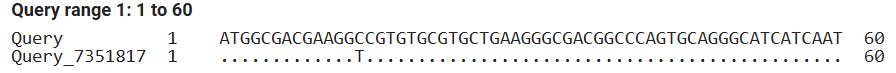

# Multi-Level Bioinformatic Analysis of the Pathogenic SOD1 p.Ala5Val Mutation in ALS1

**The SOD1 Factor** by Ferran Sánchez, Luz Hurtado, Noa Galván in collaboration with Leyre Zazpe

Introduction to Bioinformatics · UPC · 2026–2027

## Abstract

### Background
Amyotrophic lateral sclerosis 1 (ALS1) is a devastating neurodegenerative disorder characteristically driven by toxic gain-of-function variants in superoxide dismutase 1 (SOD1)[1]. Among these, the p.Ala5Val (A5V) missense mutation correlates with a rapidly progressive phenotype and severe clinical prognosis.[2]

### Results
Genomic alignment identified the single-nucleotide substitution c.14C>T in exon 1, driving a missense alanine-to-valine replacement (p.Ala4Val mature / p.Ala5Val precursor). Structural superposition revealed a local backbone displacement of 0.379 Å and a global $\text{C}_\alpha$ RMSD of 0.667 Å at the non-covalent homodimer contact interface. Steric hindrance from bulky valine methyl groups destabilizes subunit packing, leading to monomerization, loss of structural $\text{Zn}^{2+}$, and exposure of internal hydrophobic cores.[6]

### Conclusions
Our results illustrate how localized interface stress triggers cytotoxic monomer unfolding and fibrillar aggregation, bridging atomic-scale disruption to motor neuron degeneration and rapid respiratory failure in ALS1.

### Abbreviations
- **AD:** Autosomal Dominant
- **Ala / A:** Alanine
- **ALS:** Amyotrophic Lateral Sclerosis
- **AR:** Autosomal Recessive
- **ATP:** Adenosine Triphosphate
- **C9orf72:** Chromosome 9 Open Reading Frame 72
- **CDS:** Coding Sequence
- **ER:** Endoplasmic Reticulum
- **fALS:** Familial Amyotrophic Lateral Sclerosis
- **FUS:** Fused in Sarcoma
- **MD:** Molecular Dynamics
- **PDB:** Protein Data Bank
- **RMSD:** Root-Mean-Square Deviation
- **ROS:** Reactive oxygen species
- **RSS:** Reactive Sulfur Species
- **sALS:** Sporadic Amyotrophic Lateral Sclerosis
- **SOD1:** Superoxide Dismutase 1
- **TARDBP:** TAR DNA-Binding Protein
- **UPR:** Unfolded protein response
- **Val / V:** Valine
- **WT:** Wild-Type

## Keywords
- Amyotrophic Lateral Sclerosis
- SOD1
- p.Ala5Val mutation
- Homodimer interface
- Protein aggregation

## Background
>**Nomenclature note:**
Throughout this report, the target missense mutation is designated as p.Ala5Val (or c.14C>T) according to standard HGVS guidelines based on the full-length human precursor polypeptide (RefSeq NP_000445.1, 155 amino acids), which includes the initial Methionine at position 1. However, in historic clinical literature and structural databases (such as PDB ID: 2C9V), this variant is frequently referenced as p.Ala4Val (A4V) to reflect the mature, active 154-amino-acid SOD1 protein following N-terminal Methionine cleavage. Both designations refer to the exact same molecular mutation at codon 14 in exon 1.

### **Analysis of ALS1 across four specific biological levels**

Amyotrophic lateral sclerosis is a neurodegenerative disorder characterized by the death of motor neurons in the brain, brainstem, and spinal cord, resulting in fatal paralysis. ALS usually begins with asymmetric involvement of the muscles in middle adult life. Approximately 10% of ALS cases are familial. It is genetically heterogeneous, meaning that the disease phenotype is not linked to a single genetic locus, but can be triggered by pathogenic mutations across multiple distinct genes (e.g., SOD1, C9orf72, FUS, and TARDBP). Consequently, the precise genetic cause can vary significantly between patients.

Today we're going to break down the cause of the ALS1 disease on four biological levels: gene, protein, structure, and function.

### Genetic Level Causation

#### The SOD1 Gene and Locus. (Genetic heterogeneity of ALS)

Our study focuses on the SOD1 (Superoxide Dismutase 1) gene, located at chromosome 21 at locus 21q22.11.[1]

SOD1 was the first gene identified as a causative agent in ALS.

Pathogenic variants in SOD1 account for approximately 12–20% of familial ALS (fALS) cases, and 1–2% of sporadic ALS (sALS) cases worldwide.[2]

* **Mutation Profile:** Scientists have found 150 distinct mutations in the SOD1 gene that have been linked to ALS. The vast majority are missense mutations, single nucleotide substitution that leads to an aminoacid replacement in the resulting polypeptide chain. A classic example is the A5V mutation, being a substitution of alanine for valine at position 5 - which is associated with a rapidly progressive disease phenotype.
* **Inheritance can be:**

  * **Autosomal Dominant (AD):** The primary mode of inheritance for SOD1-linked ALS. A single inherited copy of the mutated allele from one parent is sufficient to trigger disease pathogenesis (e.g., the A5V variant).[3]
  * **Autosomal Recessive (AR):** Exceptionally, certain SOD1 variants display recessive inheritance, requiring two copies of the mutated allele (one from each parent) for disease expression (e.g., homozygous D90A mutation).[1]

---

### Protein Level: The Cu/Zn-SOD Enzyme

The SOD1 gene provides the instructions for creating the copper/zinc superoxide dismutase (Cu/Zn-SOD) enzyme.

- **Composition:** The mature, healthy protein consists of 154 amino acids.[4]
- The SOD1 protein, whether it is normal or mutated (wild-form or ALS1), if intramolecular disulfide bond or of bound zinc ions are absent, this protein has a tendency to form fibrillar aggregates/clumps. These aggregates may have cytotoxic effects - in other words - deadly for cells. Without its zinc and structural clips, the protein falls apart and destroys the motor neurons, so Zinc binding promotes dimerization and stabilizes the native form.
- **Quaternary State:** It naturally operates as a homodimer, meaning two identical SOD1 protein subunits must bind together to function properly. (In a non-covalent bond)
- **Cofactors:** Each SOD1 subunit requires the binding of two essential metal ions. A copper ion ($\text{Cu}^{2+}$) is critical for the enzyme's catalytic activity - while a zinc ion ($\text{Zn}^{2+}$) is required to promote dimerization and stabilize the protein's native three-dimensional folding.

#### Normal Physiological Protein Function

Physiologically, the protein functions as a vital antioxidant metalloenzyme, destroying the toxic superoxide radicals that are naturally produced within cells, therefore protecting biological systems from oxidative stress.

Furthermore, SOD1 catalyzes the oxidation of hydrogen sulfide ($\text{H}_2\text{S}$) to sulfate. This process plays an important role for detoxifying $\text{H}_2\text{S}$ and limiting the cellular accumulation of reactive sulfur species (RSS), such as persulfides and polysulfides.[5]

#### Pathological Mechanism (Fibrillar Aggregation)

Since the structural integrity is heavily dependent on its bound zinc ions and an internal structural clip,  the absence of either this disulfide bond or the bound zinc, both wild-type and ALS1-associated mutant SOD1 proteins become structurally unstable. This instability causes the protein to misfold, giving it a tendency to form fibrillar aggregates. These insoluble clumps exert severe cytotoxic effects, driving motor neuron degeneration.

---

### Structural Level: Destabilization and Aggregation

At the structural level, mutant SOD1 proteins undergo severe conformational changes that lead directly to disease pathology.

- **Normal Structure:** Healthy SOD1 folds into a highly stable, eight-stranded anti-parallel beta-barrel.[6]
- **Mutant Instability:** ALS-associated genetic mutations disrupt the protein's native folding. This severe structural instability ultimately triggers dimer dissociation, forcing the stable complex to break apart into vulnerable monomers.
- **Misfolding and Aggregation:** The dissociation of the dimer and the unfolding of the protein expose hydrophobic regions that are normally safely buried within the native structure. These destabilized, misfolded SOD1 monomers inappropriately interact with one another, initiating a cascade where they assemble into insoluble oligomers and large fibrillar aggregates. These conformational changes and the resulting clumps lead directly to disease pathology.

---

### Functional Level: Toxic Gain-of-Function

The functional breakdown of SOD1 affects specifically motor neurons.

- **Normal Function:** Healthy SOD1 acts as an essential cellular antioxidant. It scavenges highly reactive superoxide radicals ($\text{O}_2^-$)—toxic byproducts of mitochondrial energy production—and neutralizes them into ordinary molecular oxygen ($\text{O}_2$) and hydrogen peroxide ($\text{H}_2\text{O}_2$).
- **The ALS1 Mechanism:** While some loss of this antioxidant function occurs, ALS1 is driven primarily by a toxic gain-of-function. The disease is not caused by the absence of normal SOD1, but by the new, harmful properties of the mutated version.
- **Motor Neuron Death:** The structurally misfolded SOD1 aggregates physically accumulate in the cytoplasm of motor neurons. These aggregates choke the cell's internal machinery: they disrupt axonal transport, impair mitochondrial function, and induce severe endoplasmic reticulum (ER) stress. This overwhelming cellular toxicity eventually triggers apoptosis (programmed cell death), severing the communication network between the brain and muscles and resulting in fatal paralysis.[7]

## Results

### Mutant sequence findings
The wild-type (WT) coding sequence (CDS) matches the human superoxide dismutase 1 (SOD1) gene with 100% Query Cover, an E-value of 0.0, and 100.00% Percent Identity. The WT CDS of the protein sequence corresponds to the superoxide dismutase [Cu-Zn], confirming complete identity between the nucleic acid and protein records.[4]

Alignment between the WT and mutant CDS identified a single-nucleotide substitution, c.14C>T. This nucleotide change alters the fifth codon from GCC to GTC. According to the standard genetic code, the wild-type codon GCC translates to Alanine (Ala), whereas the mutated codon GTC translates to Valine (Val). Consequently, this single base change drives a missense mutation at the protein level, resulting in the p.Ala5Val substitution.[2]

**Nucleotide substitution (CDS):**

*Figure 1: Pairwise nucleotide alignment of human SOD1 CDS showing the c.14C>T substitution in exon 1.* 

**p.Ala5Val substitution:**

|  | sequence |
|---|---| 
| Query 1 | 1 - MAT**KAV**CVLKGDGPVQGIINFEQKESNGPVKVWGSIKGLTEGLHGFHVHEFGDNTAGCTS - 60 |
| Subj 1 | 1 - MAT**KVV**CVLKGDGPVQGIINFEQKESNGPVKVWGSIKGLTEGLHGFHVHEFGDNTAGCTS - 60 |

(Query 1 is the WT sequence)

### Evolutionary findings
Multiple sequence alignment of the SOD1 coding sequences across Homo sapiens, Pongo abelii, and Bos taurus reveals a highly conserved region between positions 178 and 237. Nonetheless, nucleotide variation is present: the human CDS alignment displays a 3-nucleotide gap at positions 35–37 compared to Pongo abelii, while Bos taurus exhibits additional single-nucleotide substitutions across this segment. At the protein level, SOD1 exhibits higher conservation than at the CDS level. The C-terminal domain (amino acids 121–154) is nearly identical across all three species, showing only three amino acid differences between Pongo abelii and Bos taurus. Similarly, the central domain (amino acids 61–100) is strongly conserved. Conversely, the N-terminal region (amino acids 1–60) harbors the greatest variability, containing several substitutions—such as a Valine at position 5 in Pongo abelii and Bos taurus relative to human Alanine—as well as a 2-amino-acid gap at positions 24–25 unique to Bos taurus.[4]

### Structure and functional impact findings
The c.14C>T (p.Ala5Val) missense mutation replaces a small Alanine residue with a larger, more hydrophobic Valine which favors unwanted protein aggregation. Valine is more voluminous, which can destabilize the protein structure and generates steric distortion (the increasing volume adding the methyl repels the electrons cloud ).
  
Crucially, this amino acid substitution resides within a critical functional region of SOD1: the homodimer interface. The addition of the methyl groups of the Valine interact with a neighboring Valine to generate a hydrophobic block. This alteration severely distorts the geometry of the dimer contact surface, compromising homodimer stability and disrupting proper zinc (Zn2+) coordination.
  
As a result of this increased local hydrophobicity, volume, and structural strain, the SOD1 mutant exhibits a high propensity to unfold. Once unfolded or destabilized, the exposed hydrophobic surfaces drive the formation of cytotoxic protein aggregates, a hallmark of ALS1 pathogenesis.

**Structure:**

The human SOD1 gene is located at genomic locus **21q22.11** on the long arm of chromosome 21 and is composed of 5 exons.[1] In this study model, the primary molecular cause of disease is a single-nucleotide missense mutation, **c.14C>T**, located in exon 1.[1][2] At the coding sequence level, this nucleotide substitution alters the fifth codon from "GCC" to "GTC", resulting in the substitution of an Alanine  with a Valine at position 5 of the 154-amino-acid polypeptide chain, **p.Ala5Val**.[1][2]

 **Table 1: Physicochemical and structural differences between wild-type and p.Ala5Val SOD1.**

| WT (gene) | Mutated (gene) |
|---|---|
| The gene is located at chromosome locus 21q22.11 and contains five exons. | The c.14C>T missense mutation occurs in exon 1. It causes an amino acid substitution, p.Ala5Val, in the 154-amino-acid protein. |

| WT (protein sequence) | Mutated (protein sequence) |
|---|---|
| The wild-type protein contains alanine at position 5. | The substitution of alanine with valine increases hydrophobicity and molecular volume due to valine's larger, branched side chain. These changes may affect local flexibility and the protein's secondary structure, including alpha-helix formation. |

| WT (structure) | Mutated (structure) |
|---|---|
| The wild-type protein functions as a homodimer. | The increase in side-chain volume may affect local structural packing and the dimer interface. Increased hydrophobicity may also promote abnormal protein–protein interactions, misfolding, and aggregation. |

**Figure 2:**

  

At the secondary structure level, the added side-chain bulk alters local backbone dynamics by decreasing the propensity for alpha helix formation and favoring a rigid folding such as beta sheets. Quantitative 3D structural superposition reveals a local backbone displacement of 0.379 Å at variant position 5 and an overall global Carbon alpha RMSD of 0.667 Å between wild-type and mutant structures. Although this physical alteration is minimal, its functional impact is dictated by the physicochemical properties mentioned previously, which ultimately destabilize and unfold the protein.
In the Wild-type state of SOD1 it contains a Copper ion ($\\text{Cu}^{2+}$) and a strctural Zinc ion ($\\text{Zn}^{2+}$). Residue 5 lies within the variable N-terminal domain (residues 1–60), which forms an essential part of the homodimer contact interface. This structural stress destabilizes the interface between the two subunits, causing the homodimer to separate into individual monomers. Consequently, the protein loses its structural zinc ion $\\text{Zn}^{2+}$, which its function consists in keep the homodimer structure and leads to unfold the protein.[1][6]

**Function:**
The primary biological role of wild-type SOD1 is to function as an antioxidant enzyme, catalyzing the dismutation of toxic superoxide radicals $\\text{O}\_2^{\\bullet -}$ produced during metabolic respiration into hydrogen peroxide ($\text{H}_2\text{O}_2$) and molecular oxygen ($\text{O}_2$). Also, catalyzes the oxidation of hydrogen sulfide (H2S) to sulfate, playing an important role in detoxifying H2S and limiting the accumulation of reactive sulfur species (RSS) such as persulfides and polysulfides.[5] The p.Ala5Val mutation reduces overall protein stability and impairs catalytic enzymatic activity. However, the principal disease mechanism in ALS1 is not a simple loss of function, but rather a toxic gain of function. When mutant SOD1 loses its structural zinc ion or dissociates into monomers, it partially unfolds and exposes both its internal hydrophobic core and the newly introduced Valine side chain. To minimize contact with the aqueous cellular environment, these exposed hydrophobic surfaces drive mutant SOD1 molecules to abnormally self-assemble into cytotoxic, amiloid-like fibrillar aggregates, which ultimately trigger motor neuron degeneration in ALS1.[2][7]

**Impact on Patient Function** - *Pathophysiology & Clinical Phenotype*

The primary physiological mechanism linking molecular SOD1 defects to patient dysfunction is the accumulation of misfolded Superoxide Dismutase 1 fibrillar aggregates within the neuronal cytoplasm. Motor neurons possess exceptionally long axons and high metabolic demands, making them uniquely sensitive to aggregate-induced toxicity. The accumulation of these aggregates clogs cellular machinery, driving pathogenesis through three primary mechanisms: 

The disruption of axonal transport happens when insoluble aggregates impede both anterograde and retrograde transport, impairing the delivery of essential proteins, organelles, and nutrients along the long axons of motor neuron.[8][9]

Mithocondrial disfunction happens when aggregates associate with the mitochondrial membrane, causing cellular energy failure and exacerbating intracellular oxidative stress. 

Endoplasmic reticulum stress, ER being the responsible part of the cell for protein folding, stress occurs when too many misfolded proteins build up, overloading the cell's system for fixing them and ultimately triggering a programmed cell death.[7]

*Clinical Phenotype and Symptom Progression*

The progressive apoptosis of upper motor neurons (located in the motor cortex) and lower motor neurons (located in the brainstem and spinal cord) breaks communication channels between the central nervous system and skeletal muscles.

[10][11] As motor unit degeneration advances, patients experience a characteristically progressive clinical phenotype with early motor symptoms such as muscle weakness, muscle atrophy (amyotrophy), fasciculations (involuntary muscle twitching caused by spontaneous nerve firing), and spasticity in the limbs, severely affecting voluntary tasks such as walking, gripping, and fine motor movement. [12]

Degeneration and damage of the motor neurons in the brainstem lead to dysarthria (difficulty speaking and articulating) and dysphagia (difficulty swallowing), these impairments carry critical medical risks for the patient, predisposing them to severe malnutrition and aspiration pneumonia.

At the end stage, progressive weakness spreads to the diaphragm and intercostal muscles, culminating in severe hypoventilation, fatal respiratory paralysis and failure.

*Genotype-Phenotype Correlation and Prognosis*

The clinical severity, age of onset (patient's age when those first symptoms become noticeable), and rate of disease progression vary significantly depending on the specific SOD1 point mutation present in the patient:

· A5V Mutation —> This mutation is associated with a highly aggressive, rapidly progressive clinical phenotype, resulting in severe early quadriparesis and a mean survival time of approximately 1.2 years post-onset (onset: when the first symptoms of the disease appear).

· Homozygous D90A Mutation —> This mutation displays an autosomal recessive inheritance pattern associated with a much slower, indolent disease progression, with patient survival often exceeding 10 years.

Despite variations in survival rates, the ultimate functional outcome for all affected patients is severe motor disability followed by terminal respiratory muscle failure.

## Discussion

### Structural Dynamics of the Homodimer Interface
Our structural superposition revealed a global $\text{C}_\alpha$ RMSD of 0.667 Å and a local backbone displacement of 0.379 Å at variant position 4/5. While a global RMSD under 1.0 Å typically suggests preserved tertiary topology, in human SOD1 this minimal perturbation occurs at a critical hot spot: the non-covalent homodimer contact interface (residues 1–60). Introducing a bulkier, hydrophobic Valine side chain creates severe steric hindrance against neighboring residues. This spatial distortion destabilizes the quaternary packing, triggering monomerization and subsequent detachment of the structural (Zn²⁺) ion. Without (Zn²⁺) coordination, the monomer loses thermodynamic stability, leading to local unfolding that exposes internal hydrophobic residues to the aqueous cytosol.[6][7]

### Evolutionary Divergence and Functional Tolerance
Multiple sequence alignment demonstrates high overall conservation across mammalian *SOD1* orthologs, particularly within the catalytic loop and C-terminal domains. However, the N-terminal region displays evolutionary variability. Notably, *Pongo abelii* and *Bos taurus* naturally possess a Valine at position 5 without undergoing neurodegeneration. This tolerance suggests that co-evolved compensatory mutations elsewhere in non-human primate and bovine sequences stabilize their dimer interfaces. In contrast, the human wild-type backbone relies on Alanine at position 4/5; thus, the isolated human p.Ala4Val mutation severely disrupts the precise packing network required for human dimer stability.[4]

### Pathophysiological Cascade: Toxic Gain-of-Function
The pathogenicity of p.Ala5Val stems not from loss of dismutase activity, but from a cytotoxic gain-of-function. Monomerization and exposure of hydrophobic patches drive the formation of insoluble amyloid-like fibrillar oligomers. Spinal and cortical motor neurons—characterized by long axons (up to 1 meter) and extreme metabolic demands—are uniquely vulnerable to these aggregates:

1. Axonal Transport Impairment: Aggregates physically impede molecular motors (kinesin and dynein), blocking anterograde and retrograde transport of vesicles and neurotrophic factors.[8][9]
2. Mitochondrial Collapse: Aggregate binding to the outer mitochondrial membrane impairs respiratory complexes, leading to a loss of membrane potential, ATP depletion, and elevated reactive oxygen species (ROS) generation.
3. Proteostatic & ER Stress: Accumulation of misfolded monomers overwhelms the ubiquitin-proteasome system and endoplasmic reticulum (ER) chaperones, triggering the unfolded protein response (UPR) and pro-apoptotic signaling.

### Genotype-Phenotype Correlations
The p.Ala4Val mutation correlates with one of the most aggressive forms of ALS1, exhibiting a mean post-onset survival of only ~1.2 years.[2] This contrasts sharply with the indolent, autosomal recessive D90A variant (>10 years survival). Structurally, position 4/5 sits directly within the core interface driving rapid monomer dissociation, whereas D90A lies in a peripheral surface loop where structural strain is more easily accommodated. This highlights how small differences in mutation locus determine clinical severity and disease progression.

### Limitations and Future Directions
This study relies on static crystal structures (PDB ID: 2C9V) and sequence alignments. Static structural modeling cannot capture the full conformational ensemble or solvent dynamics during monomer unfolding. Future research should integrate long-timescale molecular dynamics (MD) simulations to quantify the free energy barrier of dimer dissociation, alongside in vitro thermal shift assays to validate binding affinities and identify small molecules capable of pharmacologically stabilizing the SOD1 homodimer interface.

## Conclusions

Ultimately, this project shows how a single tiny mistake in the SuperoxideDismutase 1 gene can cause the entire motor system to fail. It proves that motor neurons are specially sensitive when damaged proteins clump together. By following the disease from a microscopic protein mistake to a patient's physical weakness, we can clearly see how biology controls the illness. 
The fact that some patients decline rapidly while others survive for over a decade, only because of a different genetic mutation, shows how complex ALS truly is. Understanding exactly how and where the cells break down is not just research, since finding these exact points of failure is the first and most important step towards creating a targeted treatment for patients.

## Methods

### Data sources
To investigate the molecular and systemic basis of Amyotrophic Lateral Sclerosis 1 (ALS1), we retrieved the complete wild-type coding sequence (CDS) and corresponding amino acid sequence of human superoxide dismutase 1 (SOD1) from the NCBI Nucleotide and Gene databases (RefSeq NM_000454.5, Gene ID 6647). Genomic coordinates at locus 21q22.11 and exon-intron architecture were mapped using NCBI RefSeq. Genetic, phenotypic, and clinical data regarding ALS1 and primary SOD1 variants, specifically p.Ala4Val (A4V) and p.Asp90Ala (D90A), were obtained from the Online Mendelian Inheritance in Man (OMIM #105400) and UniProtKB databases (UniProt ID: P00441, Disease ID: DI-00108). Enzymatic roles, metal cofactor bindings (Cu²⁺) and (Zn²⁺), and literature-curated cellular mechanisms were extracted from PubMed (PMID: 18948262, PMID: 24140062, PMID: 36630448). For cross-species conservation analysis, orthologous CDS and protein records for Pongo abelii (Gene ID: 100170281, RefSeq NM_001131969.1) and Bos taurus (Gene ID: 281495) were collected from NCBI Gene. Finally, three-dimensional atomic crystallographic coordinates for the human wild-type Cu/Zn-SOD homodimer were acquired from the RCSB Protein Data Bank (PDB ID: 2C9V).[1][4][6]

### Implementation
Pairwise nucleotide sequence alignments between the wild-type SOD1 CDS and mutant query sequences were executed using the Basic Local Alignment Search Tool for nucleotides (BLASTn) under default parameters to verify single-nucleotide point substitutions, specifically confirming the c.14C>T mutation in exon 1 driving the p.Ala5Val (A5V) substitution. The nucleotide sequence was translated in silico using the standard genetic code to evaluate open reading frame continuity and amino acid replacements. For evolutionary comparative analysis, multiple sequence alignments (MSA) of both CDS and amino acid sequences across Homo sapiens, Pongo abelii, and Bos taurus were computed using Clustal Omega to map structural and functional domains across the mature 154-amino-acid polypeptide. These mapped domains included the catalytic copper (Cu²⁺) site, structural zinc (Zn²⁺) site, conserved intramolecular disulfide bridge (Cys57–Cys146), and the eight-stranded anti-parallel β-barrel fold. Additionally, the target p.Ala4Val substitution was modeled on the three-dimensional atomic crystallographic structure (PDB ID: 2C9V) to analyze side-chain volume expansion, spatial packing alterations, and local backbone strain at the non-covalent homodimer contact interface.

To model downstream disease mechanics, we integrated a standardized pathophysiological mapping framework. Cytotoxicity was modeled through cytosolic misfolded SOD1 fibrillar aggregate accumulation in motor neurons, parameterized across three primary subcellular failure pathways:

1. Axonal Transport Disruption: Impediment of both anterograde and retrograde motor transport across extended axons.
2. Mitochondrial Dysfunction: Aggregate binding to outer mitochondrial membranes, inducing cellular energy failure and oxidative stress.
3. Endoplasmic Reticulum (ER) Stress: Accumulation of misfolded proteins exceeding ER refolding capacity, initiating apoptotic pathways.

At the systemic level, progressive loss of upper (motor cortex) and lower (brainstem/spinal cord) motor neurons was mapped to clinical phenotypes, tracking early symptoms (muscle weakness, amyotrophy, fasciculations, spasticity), bulbar impairments (dysarthria, dysphagia leading to malnutrition and aspiration pneumonia risk), and terminal respiratory failure driven by diaphragm and intercostal muscle paralysis. Furthermore, genotype-phenotype correlations were parameterized using clinical prognosis metrics: the p.Ala5Val (A5V) mutation was mapped to a rapidly progressive quadriparesis phenotype with a mean post-onset survival of ~1.2 years, whereas the homozygous p.Asp90Ala (D90A) mutation was mapped under an autosomal recessive model with an indolent course and survival exceeding 10 years.[1][2]

### Numbering convention
Sequence alignment statistics generated via BLASTn were evaluated based on Query Cover percentage, Percent Identity, and Expectation values (*E*-value), with statistical significance established at an *E*-value cutoff of *0.0*. Evolutionary amino acid conservation and the biological substitution tolerance of the p.Ala4Val (A4V) mutation across mammalian orthologs were scored using the BLOSUM62 substitution matrix, analyzing log-odds ratios to categorize conservative versus non-conservative replacements. Quantitative 3D structural superposition between wild-type and mutant crystallographic structures (PDB ID: 2C9V) was evaluated using Cα Root-Mean-Square Deviation (RMSD) in angstroms (Å) and local backbone displacement metrics to measure spatial packing strain and energetic disruption at the homodimer contact interface.

To ensure strict clarity across genetic and structural databases, variant nomenclature follows the Human Genome Variation Society (HGVS) standard relative to the mature 154-amino-acid SOD1 polypeptide. Under mature protein numbering (excluding the N-terminal initiator Methionine post-translationally cleaved in active human Cu/Zn-SOD), the alanine-to-valine substitution at codon 14 (c.14C>T) is designated as p.Ala4Val (A4V). This corresponds precisely to position 5 (p.Ala5Val) when referencing the full unprocessed precursor translation (RefSeq NP_000445.1) or full-length structural coordinates.

### Statistical Analysis
Instead of inferential hypothesis testing, our analysis relies on a quantitative bioinformatic framework. We characterized the variant by combining standard sequence alignment parameters (*E*-value = 0.0, percent identity) with structural 3D metrics ($\text{C}_\alpha$ RMSD and backbone displacement) and evolutionary conservation scoring via the BLOSUM62 matrix.

## Abbreviations
- **AD:** Autosomal Dominant
- **Ala / A:** Alanine
- **ALS:** Amyotrophic Lateral Sclerosis
- **AR:** Autosomal Recessive
- **ATP:** Adenosine Triphosphate
- **C9orf72:** Chromosome 9 Open Reading Frame 72
- **CDS:** Coding Sequence
- **ER:** Endoplasmic Reticulum
- **fALS:** Familial Amyotrophic Lateral Sclerosis
- **FUS:** Fused in Sarcoma
- **MD:** Molecular Dynamics
- **PDB:** Protein Data Bank
- **RMSD:** Root-Mean-Square Deviation
- **ROS:** Reactive oxygen species
- **RSS:** Reactive Sulfur Species
- **sALS:** Sporadic Amyotrophic Lateral Sclerosis
- **SOD1:** Superoxide Dismutase 1
- **TARDBP:** TAR DNA-Binding Protein
- **UPR:** Unfolded protein response
- **Val / V:** Valine
- **WT:** Wild-Type

## Declarations

### Availability of data and materials

### Authors' contributions

Ferran, Noa, and Luz were the primary contributors to the research, development, and integration of this project. The three of them attended all in-person and online meetings, maintaining consistent communication throughout the project. Noa led the evolutionary conservation analysis, sequence alignments, and final report integration. Ferran led the structure-function impact analysis, 3D structural mapping, and the grammar and style review. Luz completed her technical work, taking responsibility for the clinical correlation, molecular pathogenesis, and bibliography formatting. Leyre's contribution was limited to the initial repository setup to Formal Requirements and the preliminary risk assessment, as she attended only one in-person meeting before leaving the project due to personal issues.

## References

1. Online Mendelian Inheritance in Man (OMIM). Amyotrophic lateral sclerosis 1; ALS1 (Entry 105400). OMIM. 2023.

2. Gagliardi D, Ripellino P, Meneri M, et al. Clinical and molecular features of patients with amyotrophic lateral sclerosis and SOD1 mutations: a monocentric study. Front Neurol. 2023; 14: 1169689.

3. Rosen DR, et al. Mutations in Cu/Zn superoxide dismutase gene are associated with familial amyotrophic lateral sclerosis. Nature. 1993; 362(6416): 59–62.

4. The UniProt Consortium. Superoxide dismutase [Cu-Zn] (Entry P00441). UniProtKB. 2023.

5. Suthar SK, Lee SY. The role of superoxide dismutase 1 in amyotrophic lateral sclerosis: identification of signaling pathways, regulators, molecular interaction networks, and biological functions through bioinformatics. Brain Sci. 2023; 13(1): 151.

6. Protein Data Bank (PDB). Crystal structure of wild-type human Cu, Zn superoxide dismutase (PDB 2C9V). RCSB PDB. 2003.

7. Redler RL, Dokholyan NV. The complex molecular biology of amyotrophic lateral sclerosis (ALS). Prog Mol Biol Transl Sci. 2012; 107: 215-262.

8. Berth SH, Lloyd TE. Disruption of axonal transport in neurodegeneration. The Journal of Clinical Investigation. 2023; 133(11): e168554.

9. De Vos KJ, et al. Role of axonal transport in neurodegenerative diseases. Annual Review of Neuroscience. 2008; 31: 151–173.

10. Heiman-Patterson TD, et al. The motor unit in amyotrophic lateral sclerosis. NeuroRX. 2005; 2(4): 572–580.

11. Schoser BG, Blottner D. Motor unit degeneration in amyotrophic lateral sclerosis and related motor neuron diseases. Muscle & Nerve. 2006; 34(1): 1–15.

12. Burke RE. Motor units: anatomy, physiology, and functional organization. Comprehensive Physiology. 1981; 345–390.

*LINKS*

Links

https://omim.org/entry/105400

https://doi.org/10.3389/fneur.2023.1169689

https://doi.org/10.1038/362059a0

https://www.uniprot.org/uniprotkb/P00441/entry

https://doi.org/10.3390/brainsci13010151

https://www.rcsb.org/structure/2c9v

https://doi.org/10.1016/b978-0-12-385883-2.00002-3

https://doi.org/10.1172/JCI168554

https://doi.org/10.1146/annurev.neuro.31.061307.090711

https://doi.org/10.1602/neurorx.2.4.572

https://doi.org/10.1002/mus.20525

https://doi.org/10.1002/cphy.cp010210
